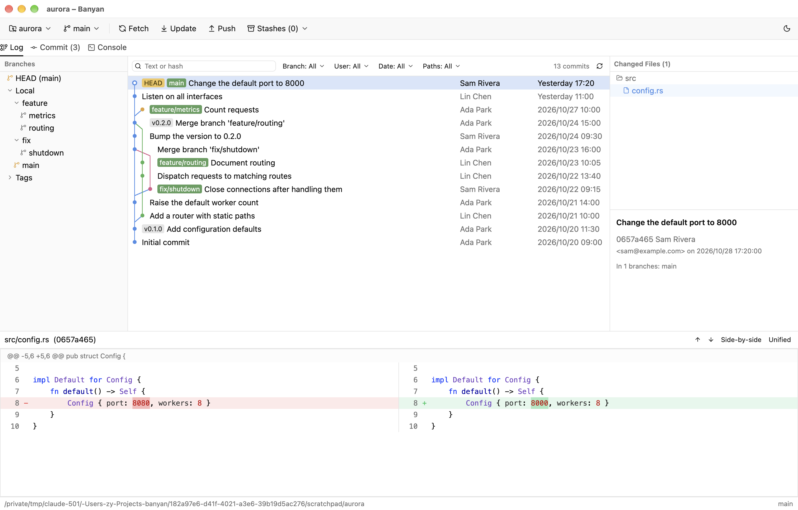
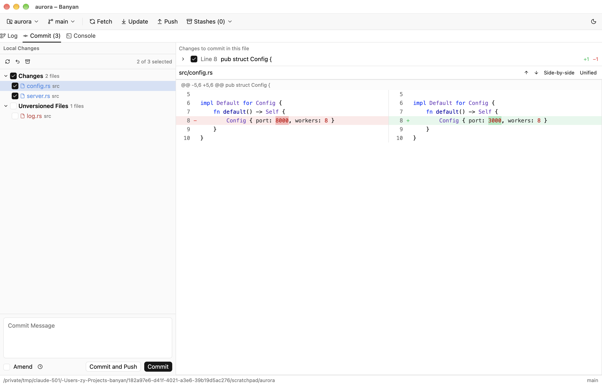
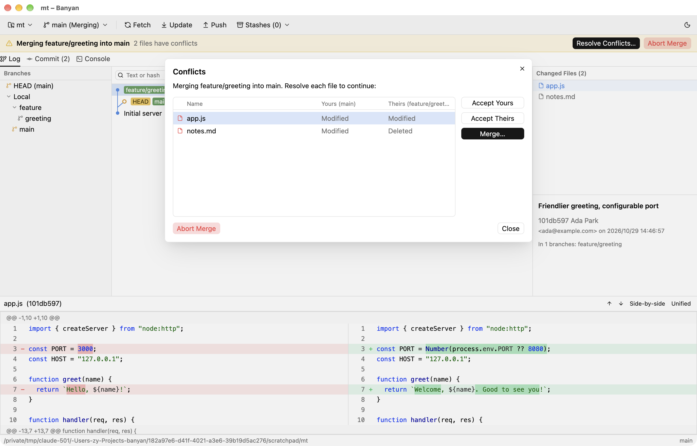
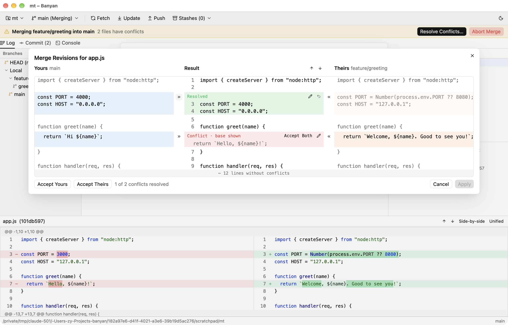

<div align="center">


# Banyan

**A fast, native Git client in the spirit of JetBrains' Git tooling.**

Built in Go with [MyGo](https://github.com/egoist/mygo)'s native UI.


</div>

<picture>
  <source media="(prefers-color-scheme: dark)" srcset="docs/screenshots/log-dark.png">
  
</picture>

## About

Banyan brings the Git workflow of JetBrains IDEs (the Log, the Commit tab, the merge tool, interactive rebase)
to a standalone app that opens instantly and does not need an IDE or a project.
It drives the `git` you already have installed, so it works with your existing config, hooks and credentials.

The name comes from the banyan tree, whose branches drop roots that grow into new trunks,
the way git branches grow apart and merge back.

## Features

### Log

- Branches tree (HEAD / Local / Remote / Tags) next to a commit graph with colored lanes and ref labels;
  commits of the current branch are in bold. **Go to Hash, Branch or Tag** (<kbd>⌘</kbd> <kbd>G</kbd>) jumps to any commit.
- Filter by text or hash, branch, date, any number of authors (with a "Me" shortcut), and files or folders; git does the filtering, so results reach past the commits loaded.
- Commit details ("in N branches"), a changed-files tree, and a side-by-side or unified diff
  with syntax highlighting. **Ignore Whitespace** above any diff leaves out whitespace-only changes.
- A merge commit's changes can be seen against either parent.
- **Cherry-Pick Selected Changes** and **Revert Selected Changes** on a file or folder of a commit apply or undo
  just that part in the work tree.
- **Compare with Local** for a file of any commit or in File History, and **Compare Commits** for two
  commits selected in the log.
- Commit context menu: copy hash, checkout, new branch / tag, cherry-pick, revert,
  reset (soft / mixed / hard), and "Show Diff with Working Tree".
  Cmd-click or Shift-click selects several commits to cherry-pick or revert together.
- Edit the current branch's history from the same menu: **Edit Commit Message**, **Fixup into Parent**,
  **Squash into Parent**, **Squash Commits** (several selected, also apart), **Drop Commit(s)** and, on the last
  commit, **Undo Commit**, which keeps its changes and puts its message back in the Commit tab. Local changes are
  stashed around the rebase, and rewriting commits that are already pushed asks first.
- **Open on GitHub** (or GitLab, Bitbucket, Gitea) and **Copy Link** for commits and files.
- Loads 5000 commits at a time (configurable), and more when you scroll to the end.

### Commit



- Changelist-style checkboxes for Changes, Unversioned Files and Merge Conflicts.
- Commit whole files, single hunks, or individual lines.
- Commit, amend, commit and push, rollback, and stash. Recent commit messages are remembered, and a subject over
  72 characters or a missing blank line before the body is pointed out.
- **Stash Changes** can stash only the checked files, leave out unversioned files, or keep the index; a stash can
  be popped, applied, dropped, or unstashed onto a new branch.
- Add to `.gitignore`, Copy Path, and Reveal in Finder for local changes.
- **Commit Options** (the gear next to the message): commit as another author, add a `Signed-off-by` line, sign
  the commit with GPG or SSH, or skip Git hooks; and set whether this repository signs every commit, with which
  key. The log shows whether each commit's signature checks out.
- **Changelists**: sort local changes into named lists from the file menu (**Move to Another Changelist**);
  new changes go to the active list, whose files are checked for the next commit. Lists can be created,
  renamed, deleted and made active from their header's menu.
- **Shelf**: put changes aside with **Shelve** (selected files, a file, or a whole changelist, new files
  included) and bring them back later from the **Shelf** tab, all at once or a file at a time, into the
  changelist they came from. A shelf that no longer fits is merged three-way, leaving conflicts to resolve.

### Merge conflicts



- When a merge, rebase, cherry-pick, revert or pull stops on conflicts, the **Conflicts** dialog opens with each
  conflicted file and what each side did to it, offering Accept Yours / Accept Theirs / Merge…
- A banner above the tabs stays until the operation is finished: **Resolve Conflicts…** while files conflict,
  then **Commit Merge** / **Continue Rebase**, and **Abort** at any time. It also picks up operations started
  outside Banyan, such as a `git merge` in the terminal.
- A conflicted file in the Commit tab shows the same actions above its diff.



- The **merge tool** shows yours, the result and theirs side by side. Changes that merge cleanly are applied
  already; each conflict takes yours (»), theirs («), both, or text you type, and shows the common ancestor
  until it's resolved. The arrows jump between conflicts. Code is syntax-highlighted and long lines wrap.
- A file deleted on one side is resolved by accepting a side.

### Branches and history

- Branch popup in the toolbar, with recently used branches and favorites (★) first: checkout (with Smart Checkout when local changes are in the way),
  new branch from, merge into current, rebase current onto, rename, and delete local, remote and tag refs.
  Any local branch can be pushed on its own, fast-forwarded to its upstream (**Update**) without checking
  it out, or set to track another remote branch (**Set Upstream**). **Compare with…** lists the commits two
  branches don't share.
- **Protected branches** (main and master by default) are never force pushed, nor are their pushed commits
  rewritten.
- **New Tag…** creates lightweight or annotated tags and can push them.
- **Create Patch** from one or more commits, **Apply Patch** from a file (Git menu or the Commit tab), and
  **Get from Revision** to bring a file back to its version in any commit.
- **Interactive rebase** from any commit: reorder, pick, reword, edit (stop to amend), squash, fixup, drop.
- **Merge with Options…**: fast-forward only or never, squash, stop before committing, or your own message.
- **File history** and **Annotate** (git blame shaded by age): click a line for its commit, step back with
  **Annotate Previous Revision**, or open the line on the web.
- **Compare with Current** for any branch, and a **stash viewer** showing each stash's files and diff.

### Remotes

- Fetch, Update Project (merge, rebase, or fast-forward only), and a **Push dialog** that lists outgoing commits and their files,
  shows the target branch, and offers push tags and force push with lease.
- **Clone Repository…** and **Manage Remotes…**.
- **Worktrees** (Git menu, repository menu, or **New Worktree from** a branch): list the repository's working
  trees, open one in its own window, add one for an existing or new branch, remove one, or forget missing ones.
- **Submodules**: see each submodule's state, update them to the recorded commits (cloning missing ones), and
  open one as a repository of its own.
- **Git Authentication** dialog for HTTPS credentials and SSH passphrases
  (Banyan acts as `GIT_ASKPASS` / `SSH_ASKPASS`). Optional background fetch.

### Several repositories in one window

- Repositories open as tabs of the current window (or in windows of their own, in Settings); each tab shows its
  branch and how many files changed. **Window › Next / Previous Repository** (<kbd>⇧</kbd> <kbd>⌘</kbd> <kbd>]</kbd> /
  <kbd>⇧</kbd> <kbd>⌘</kbd> <kbd>[</kbd>) switch between them, <kbd>⌘</kbd> <kbd>W</kbd> closes one, and
  **Git › Fetch All Repositories** and **Update All Repositories** act on them all. Drag a tab to reorder it; its
  menu closes the others, moves it to a window of its own, or copies or reveals its path.
- Branches can be handled across the window: **Checkout in All Repositories** for a branch the others have too,
  and **New Branch in All Repositories** from the branch popup.
- The tabs open last time come back when Banyan starts.

### And more

- A **Git console** tab showing every git command your actions run, with output and timing.
- Refreshes automatically when files, the index or refs change. Git-ignored files are skipped.
- Light and dark themes, or follow macOS.
- English or Simplified Chinese (简体中文), chosen in Settings.

## Installation

Download the package for your system from the [latest release](https://github.com/Zenyet/banyan/releases/latest).
Every platform needs `git` installed.

| System | Package |
| --- | --- |
| macOS 11+, Apple silicon (M1 and later) | `Banyan-<version>-macos-arm64.dmg`: open it and drag Banyan to Applications |
| macOS 11+, Intel | `Banyan-<version>-macos-x86_64.dmg` |
| Debian, Ubuntu | `banyan_<version>_amd64.deb`: `sudo apt install ./banyan_<version>_amd64.deb` |
| Other Linux | `Banyan-<version>-linux-x86_64.tar.gz`: unpack and run `banyan` |
| Windows 10+ | `Banyan-<version>-windows-x64-setup.exe` (installer) or `…-windows-x64.zip` (portable) |

The builds are not signed by Apple or Microsoft yet:

- **macOS** says Banyan "is damaged" or "cannot be opened". After copying it to Applications, run
  `xattr -dr com.apple.quarantine /Applications/Banyan.app` once.
- **Windows** SmartScreen warns about an unknown publisher: choose **More info › Run anyway**.

Banyan is developed on macOS; the Linux and Windows builds are new and less tested, so please
[report problems](https://github.com/Zenyet/banyan/issues).

### Building from source

You need [Go](https://go.dev/dl/) 1.27.3 or later and `git`. Banyan builds without cgo, so no C toolchain or
system development packages are needed, and every platform's build can be made from any machine.

```sh
git clone https://github.com/Zenyet/banyan.git
cd banyan
go run . /path/to/repo
scripts/bundle.sh                  # macOS: builds build/Banyan.app
scripts/package-macos.sh           # macOS: disk images for Apple silicon and Intel in dist/
scripts/package-linux.sh           # Linux: tarball and .deb in dist/ (needs dpkg-deb)
scripts/package-windows.ps1        # Windows: zip and installer in dist/ (needs Inno Setup)
```

The app is about 12 MB. Diffs are syntax-highlighted by MyGo's code editor.

## Usage

```sh
go run . /path/to/repo   # open a repository
go run .                 # open the repository you're in
```

Launched from Finder, Banyan reopens the last repository you used. Otherwise, and whenever you close the last
repository window, the **welcome window** offers **Open Repository…**, **Clone Repository…** and your recent
repositories. Drop a folder on the welcome window, or on any repository window, to open it; a folder that isn't
a Git repository yet can be made one. Recent repositories are also listed in the repository menu in the toolbar.

### Keyboard shortcuts

On Linux and Windows, use <kbd>Ctrl</kbd> where these show <kbd>⌘</kbd>. Commands can be given other shortcuts
in **Settings › Keyboard Shortcuts**, and **Find Action** runs any of them by name.

| Shortcut | Action |
| --- | --- |
| <kbd>⇧</kbd> <kbd>⌘</kbd> <kbd>A</kbd> | Find Action |
| <kbd>⌘</kbd> <kbd>K</kbd> | Commit (<kbd>⌘</kbd> <kbd>↩</kbd> in the message box) |
| <kbd>⇧</kbd> <kbd>⌘</kbd> <kbd>K</kbd> | Push |
| <kbd>⌘</kbd> <kbd>T</kbd> | Update Project |
| <kbd>⌘</kbd> <kbd>F</kbd> | Search the log (<kbd>↩</kbd> moves to the commits) |
| <kbd>⌘</kbd> <kbd>G</kbd> | Go to a hash, branch or tag in the log |
| <kbd>⌘</kbd> <kbd>9</kbd> / <kbd>⌘</kbd> <kbd>0</kbd> | Log / Commit tab |
| <kbd>⌘</kbd> <kbd>R</kbd> | Refresh |
| <kbd>⌘</kbd> <kbd>,</kbd> | Settings |
| <kbd>↑</kbd> <kbd>↓</kbd> <kbd>Home</kbd> <kbd>End</kbd> <kbd>PgUp</kbd> <kbd>PgDn</kbd> | Move through the commit list |
| <kbd>⌘</kbd> <kbd>Z</kbd> / <kbd>⇧</kbd> <kbd>⌘</kbd> <kbd>Z</kbd> | Undo / redo a choice in the merge tool |

Settings › Keyboard Shortcuts lists them all.

### Settings

Under <kbd>⌘</kbd> <kbd>,</kbd> you can set the theme (light, dark, or follow macOS), font size,
relative or absolute dates, the git executable, the default Update Project method, background fetch,
side-by-side or unified diffs, and how many commits the log loads at a time.

Settings, recent repositories and recent commit messages are stored in `Banyan/settings` under
`~/Library/Application Support` on macOS, `%APPDATA%` on Windows and `~/.config` on Linux. Settings from GitBrains, Banyan's earlier name,
are carried over on first launch.

## Development

```sh
go run . .         # run a debug build on this repository
go test ./...      # graph layout, ref parsing, and git operations against throwaway repositories
```

### Project layout

| File | Purpose |
| --- | --- |
| `main.go` | Entry point; answers git's credential prompts in askpass mode |
| `internal/git` | `git` CLI backend (log, status, diff, branch ops…) |
| `internal/graph` | Commit graph lane layout |
| `internal/model` | Shared repo state; runs ops in the background, watches the repository and broadcasts refreshes |
| `internal/patch`, `internal/conflict`, `internal/changelists` | Partial commits, merge conflicts and changelists |
| `internal/settings` | Persisted settings, recent repositories and commit messages |
| `internal/i18n` | English and Simplified Chinese strings |
| `internal/askpass` | Credential prompts for git and ssh |
| `internal/console` | What the Git console shows |
| `internal/app` | The interface: windows, the Log, Commit, Shelf and Console tabs, dialogs, menus and shortcuts |
| `scripts/bundle.sh` | Builds `Banyan.app` (icon, `Info.plist`, ad-hoc signature) |
| `scripts/make_icon.swift` | Draws the app icon |

## Acknowledgements

- [MyGo](https://github.com/egoist/mygo), the Go desktop framework whose native UI draws Banyan on the GPU
- [MingCute](https://www.mingcute.com) (Apache License 2.0) and [Phosphor](https://phosphoricons.com) (MIT) icons, and [Material Icon Theme](https://github.com/material-extensions/vscode-material-icon-theme)'s (MIT) for file types
- The Git integration in JetBrains IDEs, which inspired the workflow
