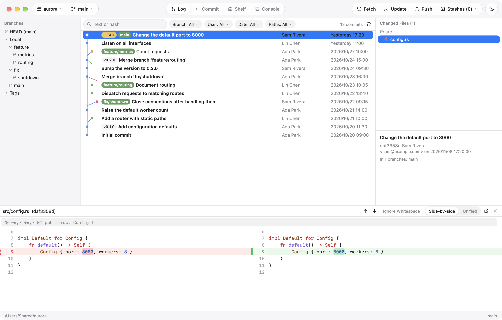
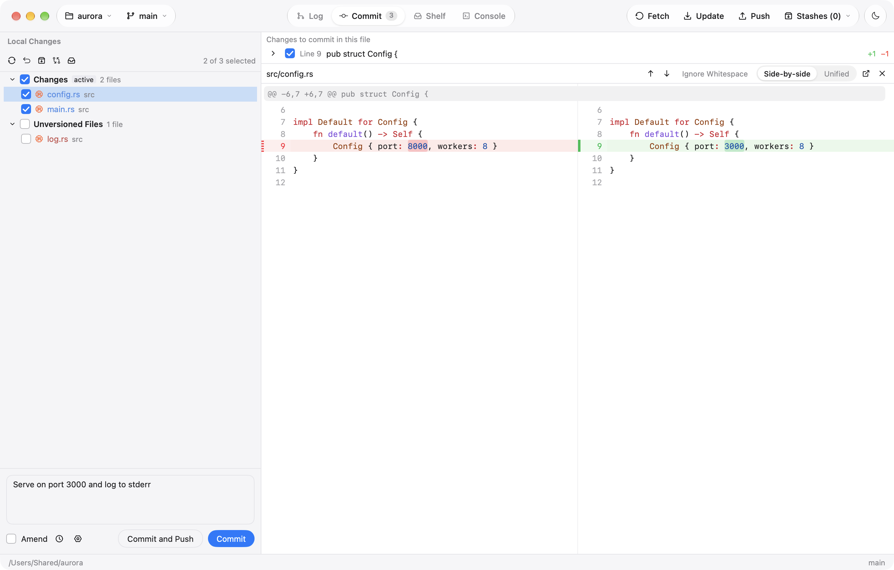
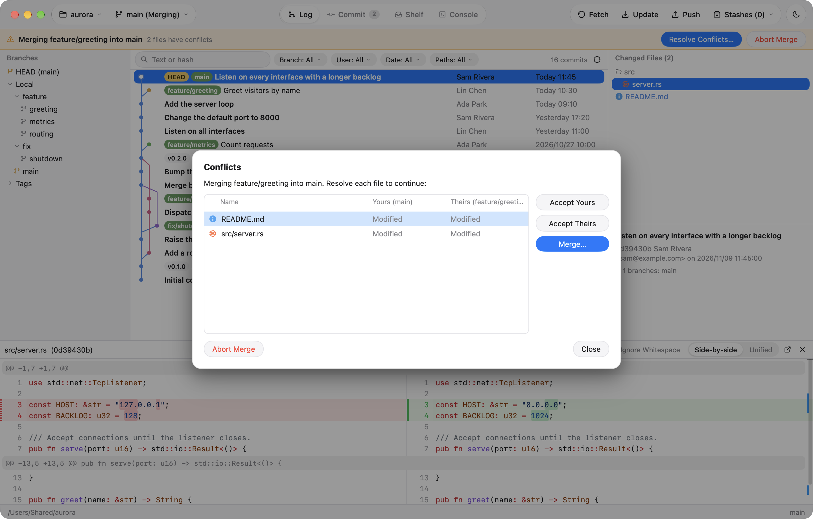
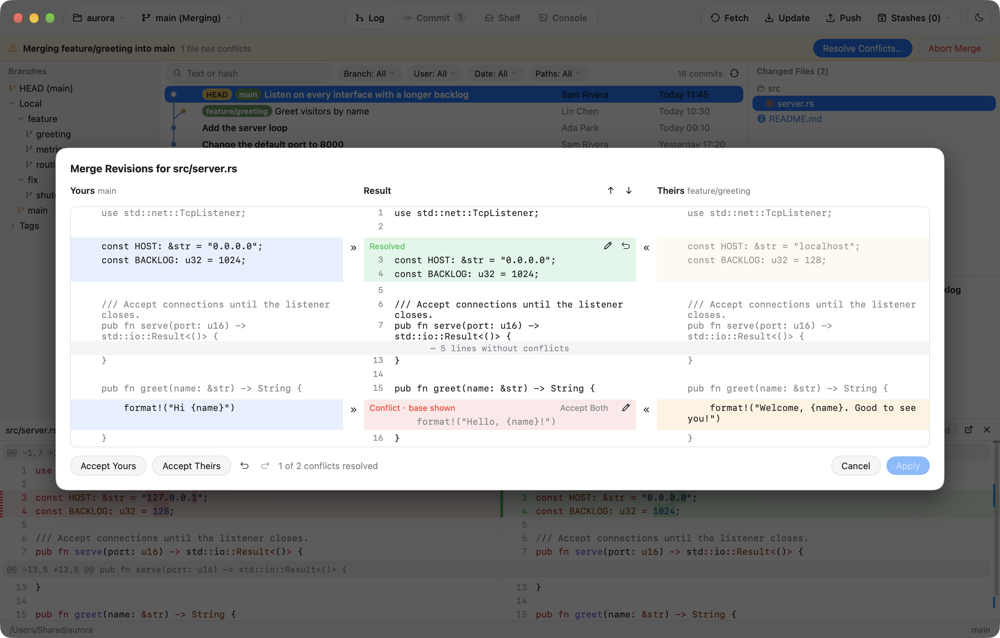

<div align="center">


# Banyan

**一个快速的原生 Git 客户端，延续 JetBrains Git 工具的使用方式。**

使用 Go 和 [MyGo](https://github.com/egoist/mygo) 的原生界面构建。


[English](README.md) · **简体中文**

</div>

<picture>
  <source media="(prefers-color-scheme: dark)" srcset="docs/screenshots/log-dark.png">
  
</picture>

## 简介

Banyan 把 JetBrains IDE 里的 Git 工作流（日志、提交页、合并工具、交互式变基）搬进一个独立应用：
打开即用，不需要 IDE，也不需要项目。它调用你已安装的 `git`，因此沿用你现有的配置、钩子和凭据。

名字来自榕树（banyan）：它的枝条垂下气根，长成新的树干，就像 Git 分支各自生长又重新合并。

Banyan 最初用 Rust 和 [GPUI](https://gpui.rs) 编写，直到 0.1.6；现在改用 Go 和
[MyGo](https://github.com/egoist/mygo) 编写，新的开发都在这里进行。Rust 版本仍保留在 [`rust/`](rust/README.md)，
照旧用 `cargo` 构建。

> 界面支持英文和简体中文，可在“设置”中切换。下文的功能名称同时给出英文原名，便于对照。

## 功能

### 日志（Log）

- 分支树（HEAD / 本地 / 远程 / 标签）与带彩色泳道和引用标签的提交图并排显示；当前分支的提交以粗体显示。
  **转到哈希、分支或标签**（Go to Hash, Branch or Tag，<kbd>⌘</kbd> <kbd>G</kbd>）可跳到任意提交。
- 可按文本或哈希、分支、日期、任意多个作者（含“我”快捷项）以及文件或文件夹筛选；筛选由 git 完成，
  因此结果不限于已加载的提交。
- 提交详情（“位于 N 个分支”）、带文件类型图标的更改文件树，以及带语法高亮的并排或统一差异。
  任意差异上方的 **忽略空白**（Ignore Whitespace）可略去仅有空白的改动。
- 日志、提交页和搁置页下方的差异可以移到单独的窗口（随选择更新），也可以隐藏，把空间让给视图；
  双击文件即可重新显示。
- 合并提交的改动可对照任一父提交查看。
- 在某个提交的文件或文件夹上使用 **优选所选更改**（Cherry-Pick Selected Changes）和 **还原所选更改**
  （Revert Selected Changes），只在工作区应用或撤销这一部分。
- 任意提交或文件历史中的文件可 **与本地比较**（Compare with Local）；在日志中选中两个提交可 **比较提交**（Compare Commits）。
- 提交右键菜单：复制哈希、签出、新建分支 / 标签、优选、还原、重置（soft / mixed / hard），以及“与工作区比较差异”。
  按住 Cmd 或 Shift 点击可多选提交，一起优选或还原。
- 在同一菜单中改写当前分支的历史：**编辑提交信息**、**修正到父提交**（Fixup）、**压缩到父提交**（Squash）、
  **压缩提交**（可选中多个、不必相邻）、**丢弃提交**，以及在最新提交上的 **撤销提交**——保留其改动，并把提交信息放回提交页。
  变基前后会自动储藏本地更改；改写已推送的提交前会先询问。
- **在 GitHub 上打开**（也支持 GitLab、Bitbucket、Gitea）和 **复制链接**，适用于提交和文件。
- 每次加载 5000 个提交（可配置），滚动到底部时继续加载。在 Linux 内核这样的大仓库中依然流畅：
  git 的 commit-graph 在后台保持最新，提交图中很长的连线在选中其提交之前以箭头表示。

### 提交（Commit）



- 更改列表风格的复选框，分为“更改”“未版本控制的文件”和“合并冲突”。
- 可提交整个文件、单个代码块（hunk）或单独的行。
- 提交、修改上次提交（amend）、提交并推送、回滚和储藏。会记住最近的提交信息，
  并提示超过 72 个字符的标题或标题与正文之间缺少空行。
- **AI 提交信息**：提交信息上方的 ✨ 按钮（或 <kbd>⌘</kbd> <kbd>⇧</kbd> <kbd>G</kbd>）会根据勾选的更改生成简洁的单行信息；
  可在 设置 › AI 中改为同时生成正文。可选择你已在使用的 ACP 智能体（Claude Code、Codex、Gemini CLI，或任何支持
  Agent Client Protocol 的命令），也可选择 OpenAI、Anthropic 或 OpenAI 兼容模型。设置 › AI 还可选择信息风格
  （跟随仓库、CodeBuddy、Conventional Commits、Gitmoji 或纯文本）、自定义指令，并测试提供方连接；生成期间你输入的内容会保留。
- **储藏更改**（Stash Changes）可以只储藏勾选的文件、排除未版本控制的文件或保留暂存区；
  储藏可以弹出、应用、删除，或取出到新分支。
- 对本地更改可添加到 `.gitignore`、复制路径、在访达中显示，以及 **删除文件**（丢弃其中的本地更改）。
- **提交选项**（Commit Options，提交信息旁的齿轮）：以其他作者身份提交、添加 `Signed-off-by` 行、
  用 GPG 或 SSH 签名提交、跳过 Git 钩子；也可设置本仓库是否对每个提交签名及所用密钥。日志会显示每个提交的签名是否有效。
- **更改列表**（Changelists）：通过文件菜单的 **移到另一个更改列表** 把本地更改分到不同的命名列表；
  新的更改进入活动列表，其中的文件会被勾选用于下次提交。列表可在其标题菜单中新建、重命名、删除和设为活动。
- **搁置**（Shelf）：用 **搁置** 把改动暂时放到一边（所选文件、单个文件或整个更改列表，包括新文件），
  之后在 **搁置** 页一次性或逐个文件恢复到原来的更改列表。若已无法直接套用，会进行三方合并，冲突留待解决。

### 合并冲突



- 合并、变基、优选、还原或拉取因冲突停下时，会打开 **冲突** 对话框，列出每个冲突文件及双方对它做的改动，
  提供“接受我方 / 接受对方 / 合并…”（双击文件即可合并）。
- 标签页上方的横幅会一直显示到操作结束：有冲突时显示 **解决冲突…**，之后显示 **提交合并** / **继续变基**，
  随时可以 **中止**。在 Banyan 之外开始的操作（如在终端里执行的 `git merge`）也会被识别。
- 提交页中的冲突文件在其差异上方提供同样的操作。



- **合并工具** 并排显示我方、结果和对方。能自动合并的改动已经应用；每处冲突可取我方（»）、对方（«）、
  两者或手动输入的文本，未解决前显示共同祖先的内容。箭头按钮在冲突之间跳转。代码带语法高亮，长行自动换行。
- 一方删除的文件，通过接受某一方来解决。

### 分支与历史

- 工具栏中的分支弹窗，最近使用和收藏（★）的分支排在前面：签出（本地更改有冲突时可用智能签出）、
  从此新建分支、合并到当前分支、将当前分支变基到此、重命名，以及删除本地、远程分支和标签。
  任意本地分支都可以单独推送、在不签出的情况下快进到上游（**更新**），或改为跟踪另一个远程分支（**设置上游**）。
  **与其他分支比较…** 列出两个分支各自独有的提交。
- **受保护分支**（默认为 main 和 master）永远不会被强制推送，其已推送的提交也不会被改写。
- **新建标签…** 可创建轻量或附注标签，并可推送。
- 从一个或多个提交 **创建补丁**，从文件 **应用补丁**（Git 菜单或提交页），以及 **从修订获取**，把文件恢复到任意提交时的版本。
- 从任意提交开始 **交互式变基**：调整顺序、pick、reword、edit（停下来修改）、squash、fixup、drop。
- **带选项合并…**：仅快进或从不快进、squash、提交前停下，或使用自定义信息。
- **文件历史** 和 **注解**（按时间深浅着色的 git blame）：点击某行查看其提交，用 **注释上一修订** 回溯，或在网页上打开该行。
- 任意分支可 **与当前比较**，**储藏查看器** 显示每个储藏的文件和差异。

### 远程

- 获取（Fetch）、更新项目（合并、变基或仅快进），以及 **推送对话框**：列出待推送的提交及其文件，显示目标分支，
  可选择推送标签和带租约的强制推送（force with lease）。
- **克隆仓库…** 和 **管理远程仓库…**。
- **工作树**（Git 菜单、仓库菜单，或从分支 **新建工作树**）：列出仓库的工作树，在单独窗口中打开，为已有或新分支添加工作树，
  删除工作树，或清理已丢失的工作树。
- **子模块**：查看每个子模块的状态，更新到记录的提交（缺失的会被克隆），或作为独立仓库打开。
- **Git 身份验证** 对话框，用于 HTTPS 凭据和 SSH 密码短语（Banyan 充当 `GIT_ASKPASS` / `SSH_ASKPASS`）。可选后台获取。

### 一个窗口打开多个仓库

- 仓库以标签页的形式在当前窗口中打开（也可在设置中改为各自独立的窗口）；每个标签页显示其分支和更改的文件数。
  **窗口 › 下一个 / 上一个仓库**（<kbd>⇧</kbd> <kbd>⌘</kbd> <kbd>]</kbd> / <kbd>⇧</kbd> <kbd>⌘</kbd> <kbd>[</kbd>）在仓库间切换，
  <kbd>⌘</kbd> <kbd>W</kbd> 关闭一个，**Git › 获取所有仓库** 和 **更新所有仓库** 对全部仓库生效。
  拖动标签页可调整顺序；其菜单可关闭其他标签页、移到单独窗口，或复制、显示其路径。
- 可跨仓库处理分支：对其他仓库也有的分支使用 **在所有仓库中签出**，或在分支弹窗中 **在所有仓库中新建分支**。
- 启动时会恢复上次打开的标签页。

### 更多

- 原生 macOS 外观：隐藏标题栏上方的 Liquid Glass 胶囊工具栏，包含仓库和分支、视图切换及其计数，
  以及获取 / 更新 / 推送按钮，执行时图标会变成加载指示。通知以玻璃横幅显示在右上角，错误信息可复制。
- **Git 控制台** 标签页，显示你的操作所执行的每条 git 命令及其输出和耗时。
- 文件、暂存区或引用变化时自动刷新，跳过被 git 忽略的文件。
- 浅色和深色主题，或跟随 macOS。
- 英文或简体中文界面，在设置中选择。

## 安装

从 [最新发布](https://github.com/Zenyet/banyan/releases/latest) 下载适合你系统的安装包。
Banyan 的所有操作都通过 `git` 完成。Windows 安装包自带 Git for Windows 的 MinGit（GPLv2，许可证随附），
在电脑上没有 Git 时使用；其他系统请先安装 `git`。如果找不到 git，Banyan 会提示如何获取。

| 系统 | 安装包 |
| --- | --- |
| macOS 12+，Apple 芯片（M1 及更新） | `Banyan-<version>-macos-arm64.dmg`：打开后把 Banyan 拖到“应用程序” |
| macOS 12+，Intel | `Banyan-<version>-macos-x86_64.dmg` |
| Debian、Ubuntu（x86_64） | `banyan_<version>_amd64.deb`：`sudo apt install ./banyan_<version>_amd64.deb` |
| 其他 Linux（x86_64） | `Banyan-<version>-linux-x86_64.tar.gz`：解压后运行 `banyan` |
| Windows 10+（x64） | `Banyan-<version>-windows-x64-setup.exe`（安装版）或 `…-windows-x64.zip`（便携版） |

支持的系统：

- **macOS 12 Monterey 或更高版本**，Apple 芯片和 Intel 均可。（Banyan 所用的 Go 已不再支持 macOS 11。）
- **Windows 10 或更高版本**，64 位 x86（x64）。没有 32 位或 Arm 版本。
- **x86_64 的 Linux**，需要 OpenGL（Debian 和 Ubuntu 上为 `libgl1`）以及 3.2 或更高版本的 Linux 内核。
  `.deb` 在 Ubuntu 22.04 上构建。没有 Arm 版本。

目前的构建尚未经过 Apple 或 Microsoft 签名：

- **macOS** 会提示 Banyan“已损坏”或“无法打开”。把它拷贝到“应用程序”后，运行一次
  `xattr -dr com.apple.quarantine /Applications/Banyan.app`。
- **Windows** SmartScreen 会警告发布者未知：选择 **更多信息 › 仍要运行**。

Banyan 主要在 macOS 上开发；Linux 和 Windows 版本较新，测试也较少，遇到问题请
[反馈](https://github.com/Zenyet/banyan/issues)。

### 从源码构建

需要 [Go](https://go.dev/dl/) 1.27.3 或更高版本以及 `git`。Banyan 不使用 cgo，因此无需 C 工具链或系统开发包，
任何平台的构建都可以在任意机器上完成。

```sh
git clone https://github.com/Zenyet/banyan.git
cd banyan
go run . /path/to/repo
scripts/bundle.sh                  # macOS：构建 build/Banyan.app
scripts/package-macos.sh           # macOS：在 dist/ 中生成 Apple 芯片和 Intel 的磁盘映像
scripts/package-linux.sh           # Linux：在 dist/ 中生成 tarball 和 .deb（需要 dpkg-deb）
scripts/package-windows.ps1        # Windows：在 dist/ 中生成 zip 和安装程序（需要 Inno Setup）
```

应用约 12 MB。差异的语法高亮由 MyGo 的代码编辑器提供。

## 使用

```sh
go run . /path/to/repo   # 打开一个仓库
go run .                 # 打开当前所在的仓库
```

从访达启动时，Banyan 会重新打开上次使用的仓库。否则，以及在关闭最后一个仓库窗口时，会显示 **欢迎窗口**，
提供 **打开仓库…**、**克隆仓库…** 和最近的仓库。把文件夹拖到欢迎窗口或任意仓库窗口即可打开；
尚未是 Git 仓库的文件夹可以就地初始化。最近的仓库也列在工具栏的仓库菜单中。

### 快捷键

在 Linux 和 Windows 上，请用 <kbd>Ctrl</kbd> 代替下表中的 <kbd>⌘</kbd>。可在 **设置 › 快捷键** 中为命令更换快捷键，
**查找操作** 可按名称运行任意命令。

| 快捷键 | 操作 |
| --- | --- |
| <kbd>⇧</kbd> <kbd>⌘</kbd> <kbd>A</kbd> | 查找操作 |
| <kbd>⌘</kbd> <kbd>K</kbd> | 提交（在信息框中为 <kbd>⌘</kbd> <kbd>↩</kbd>） |
| <kbd>⇧</kbd> <kbd>⌘</kbd> <kbd>K</kbd> | 推送 |
| <kbd>⌘</kbd> <kbd>T</kbd> | 更新项目 |
| <kbd>⌘</kbd> <kbd>F</kbd> | 搜索日志（<kbd>↩</kbd> 移到提交列表） |
| <kbd>⌘</kbd> <kbd>G</kbd> | 在日志中转到哈希、分支或标签 |
| <kbd>⌘</kbd> <kbd>9</kbd> / <kbd>⌘</kbd> <kbd>0</kbd> | 日志 / 提交页 |
| <kbd>⌘</kbd> <kbd>R</kbd> | 刷新 |
| <kbd>⌘</kbd> <kbd>,</kbd> | 设置 |
| <kbd>↑</kbd> <kbd>↓</kbd> <kbd>Home</kbd> <kbd>End</kbd> <kbd>PgUp</kbd> <kbd>PgDn</kbd> | 在提交列表中移动 |
| <kbd>⌘</kbd> <kbd>Z</kbd> / <kbd>⇧</kbd> <kbd>⌘</kbd> <kbd>Z</kbd> | 在合并工具中撤销 / 重做选择 |

完整列表见 设置 › 快捷键。

### 设置

在 <kbd>⌘</kbd> <kbd>,</kbd> 中可以设置主题（浅色、深色或跟随 macOS）、语言、字号、相对或绝对日期、
提交所用的姓名和邮箱（写入 git 全局配置）、git 可执行文件、更新项目的默认方式、后台获取、
并排或统一差异、日志每次加载的提交数，以及 AI 提交信息的来源。

设置、最近的仓库和最近的提交信息保存在 `Banyan/settings` 中，位于 macOS 的 `~/Library/Application Support`、
Windows 的 `%APPDATA%` 或 Linux 的 `~/.config` 下；文件仅你可读，因为其中可能保存 AI 提供方的 API 密钥。
首次启动时会迁移 Banyan 旧名 GitBrains 的设置。

## 开发

```sh
go run . .         # 在本仓库上运行调试版本
go test ./...      # 提交图布局、引用解析，以及在临时仓库上测试 git 操作
```

### 项目结构

| 文件 | 用途 |
| --- | --- |
| `main.go` | 入口；在 askpass 模式下回答 git 的凭据提示 |
| `internal/git` | `git` 命令行后端（log、status、diff、分支操作…） |
| `internal/graph` | 提交图泳道布局 |
| `internal/model` | 共享的仓库状态；在后台运行操作、监视仓库并广播刷新 |
| `internal/patch`、`internal/conflict`、`internal/changelists` | 部分提交、合并冲突和更改列表 |
| `internal/ai` | 生成提交信息：OpenAI 兼容 API 或 ACP 智能体 |
| `internal/settings` | 持久化的设置、最近的仓库和提交信息 |
| `internal/i18n` | 英文和简体中文文案 |
| `internal/askpass` | git 和 ssh 的凭据提示 |
| `internal/console` | Git 控制台显示的内容 |
| `internal/app` | 界面：窗口，日志、提交、搁置和控制台标签页，对话框、菜单和快捷键 |
| `scripts/bundle.sh` | 构建 `Banyan.app`（图标、`Info.plist`、临时签名） |
| `scripts/make_icon.swift` | 绘制应用图标 |
| `rust/` | Rust 版本，有自己的 [README](rust/README.md) |

## 致谢

- [MyGo](https://github.com/egoist/mygo)，用 GPU 绘制 Banyan 原生界面的 Go 桌面框架
- [MingCute](https://www.mingcute.com)（Apache License 2.0）和 [Phosphor](https://phosphoricons.com)（MIT）图标，以及 [Material Icon Theme](https://github.com/material-extensions/vscode-material-icon-theme)（MIT）的文件类型图标
- JetBrains IDE 中的 Git 集成，启发了本应用的工作流

## 许可证

Banyan 以 [MIT 许可证](LICENSE) 发布。Windows 安装包附带的 Git for Windows MinGit 沿用其自身的许可证（GPLv2）。
